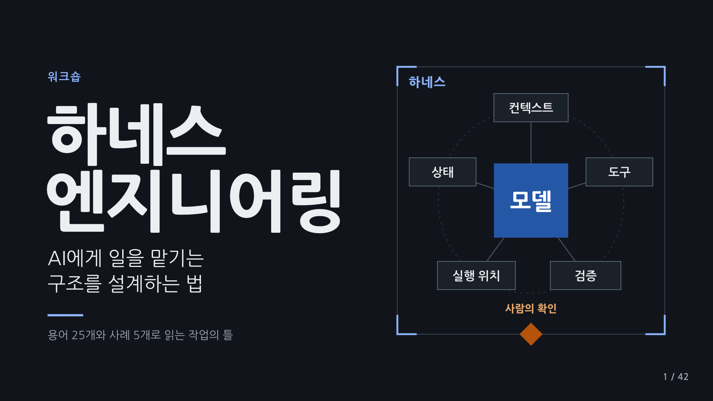

> 제작 브랜치 `develop`입니다. 최신 제작본은 v20(46장, 공개 전 초안)이고, 현재 공개 자료(v15)는 [main](https://github.com/indra622/harness-engineering-workshop/tree/main)에서 볼 수 있습니다.
> 소스, 기획서, 과거 버전과 중간 산출물은 이 브랜치에 보관합니다. 일반 수정은 여기서 진행하고 공개판으로 확정할 때만 선택된 HTML/PDF를 `main`에 반영합니다. [운영 규칙](AGENTS.md)을 따릅니다.

# 하네스 엔지니어링 워크샵

하네스 엔지니어링 워크숍의 용어 설명과 사례를 준비하는 작업 디렉토리다.

## 현재 기준

- 발표 자료는 v20(제작본, 공개본은 v15)이다. v20은 14쪽 OMH 사례 바로 뒤 15쪽에 '며칠을 만들었는데, 옮겨 보니 이미 있었다'(사례 2 이어서)를 넣었다. 작성자가 OMH v05를 며칠 동안 만든 뒤 OMP로 옮겨 보니 상당 부분이 기본 기능이었고, v06은 필요한 절차만 얇게 남겼다는 경험이다. 그 뒤 쪽은 한 장씩 밀렸다(참고 A, B 16, 17쪽, Grokbot 21쪽, 참고 C 22쪽, AI교양 29쪽, CEO Agent 35쪽, 질의응답 45쪽, 맺음말 46쪽). 근거는 [docs/references/omh-omp-evolution-v01.md](docs/references/omh-omp-evolution-v01.md), 제작 메모는 [docs/production/evolution-v20.md](docs/production/evolution-v20.md)에 있다. v19는 질의응답(44쪽) 뒤 마지막 45쪽에 조용한 맺음말 '만들어 보고도, 남아 있는 질문'을 붙였다. 1쪽부터 44쪽은 v18 그대로다. 제작 메모는 [docs/production/reflection-v19.md](docs/production/reflection-v19.md)에 있다. v18은 v17의 44쪽 마무리를 삭제해 종합 다음에 질의응답이 바로 이어지며 총44장이다. v17은 21쪽의 세 서비스 카드에 AILC 원본의 OpenAI, Grok, Meta 로고를 추가했다. 그 밖의 화면과 45장 구성은 v16 그대로다. v16은 20쪽 Grokbot 사례를 작성자가 확인한 네 봇(록식이, 에식이, 소식이, 최저가봇)과 공유 클라우드로 다시 그리고, '늘 켜 둔 내 장비 없이도 하네스를 쓸 수 있음'을 크게 보였다. 바로 뒤 21쪽에 참고 C(dots, Grok Bot, Muse 세 클라우드 개인 에이전트)를 넣어 45장(참고 3장)이 됐고, 그 뒤 쪽은 한 장씩 밀렸다(AI교양 28쪽, 쉬는 시간 29쪽, CEO Agent 34쪽, 질의응답 45쪽). 근거는 [docs/references/cloud-personal-agents-v01.md](docs/references/cloud-personal-agents-v01.md), 제작 메모는 [docs/production/cloud-agents-v16.md](docs/production/cloud-agents-v16.md)에 있다. v15는 14쪽 ‘쓰는 이유’ 두 줄을 반복성과 복잡성에 따른 효용으로 바꿨다. 도식과 다른 43쪽은 그대로다. [제작 메모](docs/production/reuse-v15.md). v14는 v13에서 14쪽만 바꿨다. 왼쪽 OpenCode 순정에 같은 요청을 진행하는 네 단계(표를 고침, 원본과 비교, 기준에 따라 검토, 필요하면 다시 맡김)를 두고, 화면 아래 각주를 빼서 '쓰는 이유' 띠를 그 자리로 내렸다. 사실 경계는 노트에 있다. 제작 메모는 [docs/production/process-v14.md](docs/production/process-v14.md)에 있다. v13은 v12에서 14쪽만 바꿨다. 14쪽 OMH는 '빈칸만 채우랬는데, 번호까지 바뀌었다면?'으로, '표의 금액 빈칸만 0으로 채워 줘. 번호와 상품은 그대로'라는 요청을 총괄, 작업 담당, 검토 담당의 역할 흐름으로 보인다. 검토 담당이 준비된 비교 도구로 요청 밖 번호 변경을 찾고, 같은 총괄이 다시 고치게 한 뒤 검토 통과 뒤에 보고한다. 바뀐 내용은 v12와 같은 합성 예시의 실제 도구 결과이고, 역할 흐름은 설명용이다. 제작 메모는 [docs/production/roles-v13.md](docs/production/roles-v13.md)에 있다. v12는 v11에서 14쪽, 15쪽, 27쪽만 바꿨다. 14쪽 OMH는 '행 수는 그대로, 빠진 ID까지 찾아내기'로, 행 수와 빈 값만 보면 통과인 첫 결과에서 id 기준 data_compare가 사라진 ID 1건과 새 ID 1건을 찾고, 검토 기준에 걸려 완료 전에 되돌린 뒤 수정 결과를 확인하는 장면이다. 개수는 [examples/omh-v12/](examples/omh-v12/README.md)의 합성 CSV에 도구를 실제로 실행한 결과이고, 역할과 검토 흐름은 설명용이다. 15쪽은 요지 '기본기는 모델에, 업무 기준과 위임은 하네스에'를 제목으로 올리고 Superpowers 다음에 pstack을 읽도록 순서를 바꿨다. 27쪽 AI교양은 2쪽과 같은 일곱 단계 흐름으로 맞췄다. 제작 메모는 [docs/production/impact-v12.md](docs/production/impact-v12.md)에 있다. v11은 v10에서 15쪽과 16쪽만 바꿨다. 15쪽 참고 A는 '기본기 다음은, 검증과 위임'으로, 계획, 구현, 테스트, 반복 수정 같은 실행 기본기(Superpowers, 잘 만든 기본 절차) 위에 성공 기준과 근거, 작업별 절차 선택, 범위 정한 위임, 돌아온 결과 검증이라는 업무 운영 층(pstack에서 참고)을 두는 강조점을 보인다. AS-IS, TO-BE 표기와 전환 화살표는 뺐다. 16쪽 참고 B는 라벨과 노트를 맞췄다. 사실과 해석의 구분과 출처는 [docs/references/pstack-superpowers-comparison-v03.md](docs/references/pstack-superpowers-comparison-v03.md), 제작 메모는 [docs/production/framing-v11.md](docs/production/framing-v11.md)에 있다. v10은 v09에서 14쪽, 15쪽, 16쪽만 바꿨다. 14쪽 OMH는 같은 일(CSV 빈 값 처리 후 무엇이 바뀌었는지 확인)을 'OpenCode 순정'과 'OMH 통합 구성'으로 비교하고, OMH 경계 안에 OMO와 업무 도구, 작업 절차를 함께 그렸다(OMO의 역할 구성까지 묶은 OMH). 15쪽 참고 A는 Superpowers를 AS-IS, pstack을 TO-BE로 놓은 이 발표의 전환 방향을 보이고, 16쪽 참고 B는 그 방향에 맞춰 라벨과 노트를 고쳤다. 근거와 관점은 [docs/references/pstack-superpowers-comparison-v02.md](docs/references/pstack-superpowers-comparison-v02.md), 제작 메모는 [docs/production/comparison-axes-v10.md](docs/production/comparison-axes-v10.md)에 있다. v09에서는 9쪽 게이트웨이에 채널, 세션, 스케줄러를 표시했다. 사례 이름은 화면과 목차에서 클식이로 통일했다. 기반 소프트웨어 OpenClaw와는 노트에서 구분한다. 9쪽 코디네이터 상자에 업무 난이도를 자동 판단한다고 표시하고 직접 처리와 워커 위임으로 이어지게 했다. 44장(본문 42장과 참고 2장). [slides/index.html](slides/index.html)을 연다. v07은 v06 본문을 그대로 두고, OMH 사례(14쪽) 바로 뒤에 선택형 참고 화면 두 장을 넣었다. 참고 A(15쪽)는 같은 기능 추가 요청에서 pstack과 Superpowers가 먼저 챙기는 것을 나란히 보이고, 참고 B(16쪽)는 가져올 것을 기능 목록보다 작업 방식으로 정리하며 OMH를 적용 예로 든다. 두 장은 '본문으로, 17쪽' 링크로 건너뛸 수 있고, 근거는 [docs/references/pstack-superpowers-comparison-v01.md](docs/references/pstack-superpowers-comparison-v01.md), 제작 메모는 [docs/production/reference-slides-v07.md](docs/production/reference-slides-v07.md)에 있다. 원래 15쪽부터는 두 장씩 밀렸다(쉬는 시간 28쪽, CEO Agent 33쪽, 질의응답 44쪽). v06은 v05의 구성과 디자인을 그대로 두고 문구와 역할 표현을 점검했다. 9번 OpenClaw 도식은 코디네이터가 요청을 직접 처리하거나 워커에게 위임하고, 돌아온 결과를 같은 코디네이터가 확인하는 구조로 다시 그렸다. 14번 OMH는 같은 일(CSV 빈 값 처리 후 무엇이 바뀌었는지 확인)을 업무 도구와 절차를 더하기 전과 후로 나란히 비교한다. 부모, 쓰기 주체, 등록처럼 행위자가 흐리거나 구현 내부에서 온 표현은 누가 무엇을 하는지 드러나게 고쳤다. 점검 기록은 [docs/production/wording-audit-v06.md](docs/production/wording-audit-v06.md)에 있다. v05는 3페이지 목차의 쉬는 시간 표시를 없애고 다섯 항목의 간격을 맞췄다. v04는 v03의 구성과 도식을 그대로 두고, 강의 시간 배분을 화면과 발표자 노트와 목록 파일에서 모두 뺐으며, 화면 문구를 발표용 문장으로 다시 다듬었다. 쪽 번호와 2번 슬라이드의 작가 중심 순서(작가가 주제를 고르고 초고 v01을 직접 쓴 뒤 AI와 함께 다듬음)는 그대로다.
- [슬라이드별 내용 정의 v10](docs/plans/slide-content-plan-v10.md): 용어와 사례의 뜻, 장면, 사실 제약의 기준. 발표자 노트에 표시한 정정(v06 번호로 2, 9, 18, 23, 29, 30, 31번, v07 쪽으로는 2, 9, 20, 25, 31, 32, 33쪽)만 v10보다 우선한다. v10에서는 14쪽 비교 기준에 관한 정정도 내용 기획보다 우선한다. v06과 v07 노트의 v10 발췌는 강의 시간 표기를 빼고 화면과 맞지 않던 표현 몇 곳을 현재 표현으로 바꾼 편집본이며, 원문은 이 파일에 그대로 있다.
- [슬라이드 제작 브리프 v02](docs/production/slide-production-brief-v02.md): 다섯 장 구성, 42장 화면 지도, 배치 계열, v02 정정. 이 브리프의 시간 배분은 v02와 v03 기준의 기록이며 v04에는 적용하지 않는다.
- [DESIGN.md](DESIGN.md): v02 디자인 기준(표준 절 순서). v01 디자인은 [docs/design/DESIGN-v01.md](docs/design/DESIGN-v01.md)에 보존했다.
- 용어 25개를 각각 독립 슬라이드에서 설명하고, 사례 다섯 개(클식이, OMH, Grokbot, AI교양, CEO Agent)를 관련 용어 바로 뒤에 둔다. CEO Agent는 한 장이다. 3장과 4장 사이에 쉬는 시간이 있고, 참가자 실습은 없다.

## 폴더

- `docs/plans/`: 슬라이드 내용 정의 v01부터 v10. 내용 기준은 v10이다.
- `docs/production/`: 슬라이드 제작 브리프 v01(이전 판)과 v02(현재).
- `docs/design/`: v01 디자인 사본과 v02 시안 단계의 제안.
- `docs/notes/`: 초기 강사용 워크샵 노트와 개정본.
- `slides/`: 발표 자료, PDF, 발표자 노트와 빌드 소스(`slides/src/`).
- `assets/`: 현재 발표 자료의 표지 미리보기와 시각자료.

## 발표 자료 v20 (현재 제작본)

HTML이 기준 산출물이다. 도식은 모두 편집 가능한 인라인 SVG와 실제 텍스트이며, 화면 전체를 이미지로 넣지 않았다. 네트워크 없이 열리고 외부 글꼴이나 CDN을 쓰지 않는다.

- [slides/index.html](slides/index.html): 현재 입구. 단일 파일이라 파일 하나만 보내도 열린다.
- [slides/harness-engineering-workshop-v20.html](slides/harness-engineering-workshop-v20.html): 기준 단일 파일 내보내기. `index.html`과 같은 내용이다.
- [slides/harness-engineering-workshop-v20.pdf](slides/harness-engineering-workshop-v20.pdf): 브라우저 인쇄로 만든 46쪽, 16:9 PDF. 쪽마다 번호가 찍힌다.
- [slides/speaker-notes-v20.md](slides/speaker-notes-v20.md): 발표자 노트 전문. 참고 화면 노트에는 고정 커밋의 출처 링크가 있다. 용어와 사례 슬라이드에는 v10 해당 블록의 편집 발췌(강의 시간 표기를 빼고 일부 표현을 현재 표현으로 바꿈)가 들어 있고, 정정이 필요한 곳은 정정이 발췌보다 먼저 나온다.
- [slides/harness-engineering-workshop-v20.manifest.json](slides/harness-engineering-workshop-v20.manifest.json): 화면 번호, 원래 번호(`original`), 참고 표시(`reference`), 종류, 배치, 장, 용어, 사례, v10 출처 목록과 발췌에서 바꾼 표현 목록(`excerpt_edits`). 같은 정보가 각 슬라이드의 `data-` 속성에도 있다.
- [slides/v20-check-evidence.json](slides/v20-check-evidence.json): 최근 브라우저 검사 결과.

조작: 오른쪽, 아래, PageDown, 스페이스는 다음, 왼쪽, 위, PageUp은 이전, Home과 End는 처음과 끝, N은 발표자 노트, F는 전체 화면이다. `index.html#s35`이나 `#35`처럼 슬라이드 번호로 바로 연다. `?notes=1`을 붙이면 노트가 열린 채로 시작한다. 인쇄하면 슬라이드마다 한 쪽씩 나온다. 쪽 번호는 화면 오른쪽 아래에 "n / 46"로 보인다.

글꼴은 Nanum Gothic을 기본으로 쓰고, 없으면 Apple SD Gothic Neo, Malgun Gothic, Noto Sans KR 순으로 대체된다. 렌더와 검사는 Nanum Gothic으로 했다.

다시 만들기와 점검은 [slides/src/README.md](slides/src/README.md)에 있다.

## 이전 판 (보존)

- v19 발표 자료: [HTML](slides/harness-engineering-workshop-v19.html), [PDF](slides/harness-engineering-workshop-v19.pdf), [발표자 노트](slides/speaker-notes-v19.md). 45장, OMH 이어지는 장이 없던 판.
- v18 발표 자료: [HTML](slides/harness-engineering-workshop-v18.html), [PDF](slides/harness-engineering-workshop-v18.pdf), [발표자 노트](slides/speaker-notes-v18.md). 44장, 질의응답으로 끝나던 판.
- v15 발표 자료 (현재 공개본): [HTML](slides/harness-engineering-workshop-v15.html), [PDF](slides/harness-engineering-workshop-v15.pdf), [발표자 노트](slides/speaker-notes-v15.md). 44장, 20쪽이 사용자 설명 기반 비교 축 화면이던 판.
- v14 발표 자료: [HTML](slides/harness-engineering-workshop-v14.html), [PDF](slides/harness-engineering-workshop-v14.pdf), [발표자 노트](slides/speaker-notes-v14.md). 14쪽의 선택 이유를 반복성과 복잡성 중심으로 바꾸기 전 판.

- v13 발표 자료: [HTML](slides/harness-engineering-workshop-v13.html), [PDF](slides/harness-engineering-workshop-v13.pdf), [발표자 노트](slides/speaker-notes-v13.md). 14쪽 왼쪽이 준비물 목록이고 화면 아래 각주가 있던 판.
- v12 발표 자료: [HTML](slides/harness-engineering-workshop-v12.html), [PDF](slides/harness-engineering-workshop-v12.pdf), [발표자 노트](slides/speaker-notes-v12.md). 14쪽을 CSV와 도구 결과 네 칸 장면으로 보이던 판.
- v11 발표 자료: [HTML](slides/harness-engineering-workshop-v11.html), [PDF](slides/harness-engineering-workshop-v11.pdf), [발표자 노트](slides/speaker-notes-v11.md). 14쪽 구성 비교, 15쪽 업무 운영 층이 위에 있던 그림, 27쪽 네 단계 압축 흐름의 판.
- v10 발표 자료: [HTML](slides/harness-engineering-workshop-v10.html), [PDF](slides/harness-engineering-workshop-v10.pdf), [발표자 노트](slides/speaker-notes-v10.md). 15쪽을 AS-IS Superpowers, TO-BE pstack으로 표기하던 판.
- v09 발표 자료: [HTML](slides/harness-engineering-workshop-v09.html), [PDF](slides/harness-engineering-workshop-v09.pdf), [발표자 노트](slides/speaker-notes-v09.md). 14쪽 비교 축(OpenCode와 OMO를 공통 기반으로 둔 추가 전과 추가 후)과 15쪽 나란히 비교를 바꾸기 전 판.
- v08 발표 자료: [HTML](slides/harness-engineering-workshop-v08.html), [PDF](slides/harness-engineering-workshop-v08.pdf). 9쪽 게이트웨이에 스케줄러를 표시하기 전 판.

- v07 발표 자료: [HTML](slides/harness-engineering-workshop-v07.html), [PDF](slides/harness-engineering-workshop-v07.pdf). 9쪽 자동 난이도 판단 표기를 더하기 전 판.

- v06 발표 자료: [HTML](slides/harness-engineering-workshop-v06.html), [PDF](slides/harness-engineering-workshop-v06.pdf), [발표자 노트](slides/speaker-notes-v06.md). 참고 화면을 넣기 전 42장 판.
- v05 발표 자료: [HTML](slides/harness-engineering-workshop-v05.html), [PDF](slides/harness-engineering-workshop-v05.pdf), [발표자 노트](slides/speaker-notes-v05.md). v06 문구 점검 직전 판.
- v04 발표 자료: [HTML](slides/harness-engineering-workshop-v04.html), [PDF](slides/harness-engineering-workshop-v04.pdf), [발표자 노트](slides/speaker-notes-v04.md). 목차의 쉬는 시간 표시를 뺀 v05 직전 판.

- v03 발표 자료: [slides/harness-engineering-workshop-v03.html](slides/harness-engineering-workshop-v03.html), [slides/harness-engineering-workshop-v03.pdf](slides/harness-engineering-workshop-v03.pdf), [slides/speaker-notes-v03.md](slides/speaker-notes-v03.md), `slides/harness-engineering-workshop-v03.manifest.json`, `slides/v03-check-evidence.json`. 120분 일정 기준. 쪽 번호와 2번 슬라이드 정정을 처음 넣은 판이며, `--version v03`으로 다시 빌드하면 같은 바이트가 나온다.
- v02 발표 자료(120분 일정 기준): [slides/harness-engineering-workshop-v02.html](slides/harness-engineering-workshop-v02.html), [slides/harness-engineering-workshop-v02.pdf](slides/harness-engineering-workshop-v02.pdf), [slides/speaker-notes-v02.md](slides/speaker-notes-v02.md), `slides/harness-engineering-workshop-v02.manifest.json`, `slides/v02-check-evidence.json`. 내보낸 그대로 보존했고, `--version v02`로 다시 빌드하면 같은 바이트가 나온다.
- v01 발표 자료: [slides/harness-engineering-workshop-v01.html](slides/harness-engineering-workshop-v01.html)(단일 파일), [slides/harness-engineering-workshop-v01.pdf](slides/harness-engineering-workshop-v01.pdf)(35쪽), [slides/speaker-notes.md](slides/speaker-notes.md)(v01 노트). v01 입구 파일은 `slides/index-v01.html`로 옮겼고 `slides/assets/`의 CSS와 JS를 쓴다.
- v02 시안 여섯 장: `slides/previews/redesign-v02.html`, `.pdf`, `slides/previews/redesign-v02/`.
- `slides/previews/`의 PPTX 여섯 장은 더 이전 단계의 선택형 실험 결과이며 기준 산출물이 아니다.

## 작업 원칙

이 디렉토리를 이후 작업의 기준으로 사용한다. 개정은 새 버전 파일로 저장하고 이전 버전은 보존한다. 발표자료 주요 작성과 수정은 공식 Claude Remote Control 경로를 따른다. 기존 원격 세션의 작업 트리는 자동으로 이 경로로 옮겨진 것이 아니다. 후속 작성 전에 새 경로를 작업자에게 명시한다.

## 버전과 공개 범위

현재 제작본은 v16(공개본 v15), 내용 정의는 v10이다. 과거 버전과 초기 노트는 개정 이력으로 보존하며 현재 진행안과 다를 수 있다.

공개본은 로컬 절대 경로를 논리 경로로 바꿨다. `ceo-agent/`와 `workspace/`로 적힌 근거 자료는 이 저장소에 포함되지 않은 로컬 참고 자료다. CEO Agent의 실제 페르소나, 회사 내부 자료, 보고서, 인증정보와 실행 로그는 포함하지 않는다. Grokbot 첨부 원자료도 포함하지 않는다. 로컬 원본과 복사 검증 파일은 별도로 보존한다.
